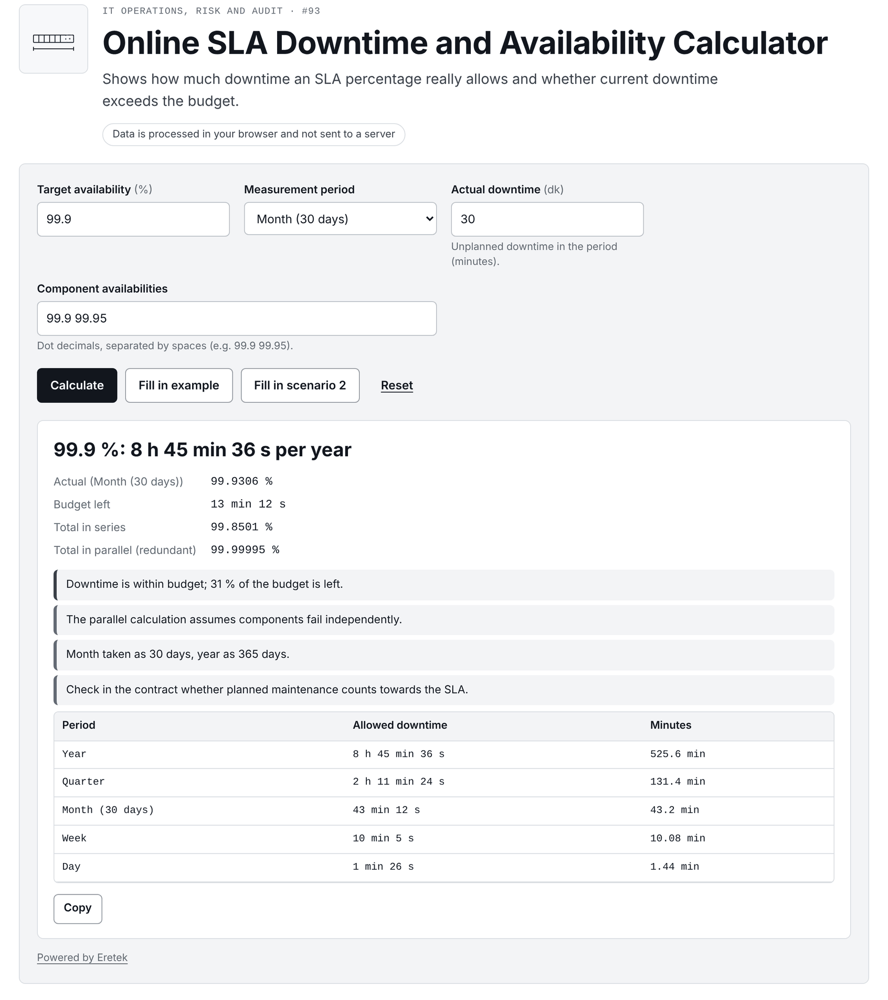

# SLA Downtime and Availability Calculator

Calculate allowed downtime per year, month, week and day from an SLA percentage, actual availability and serial/parallel component availability.

## Try it live

- [Türkçe](https://sistem.eretek.com/araclar/sla-kesinti-hesaplama)
- [English](https://sistem.eretek.com/en/tools/sla-downtime-calculator)
- [Deutsch](https://sistem.eretek.com/de/werkzeuge/sla-verfuegbarkeitsrechner)



## What it does

Shows how much downtime an SLA percentage really allows and whether current downtime exceeds the budget.

99.9 % sounds high but means 43 minutes a month and 8 hours 45 minutes a year. SLA negotiation, maintenance planning and post-incident reporting all need these minutes. The tool calculates the downtime budget per period, the actual availability from measured downtime and the total availability of a service built from dependent components.

## Where it helps

State clearly in the SLA whether planned maintenance counts and what the measurement period is. Plan maintenance windows with the Maintenance Window tool and measure incident times with the MTTA/MTTR tool.

## How to use it

1. Enter the target availability in percent.
2. Optionally enter the period and total downtime in that period (minutes).
3. Enter component availabilities separated by spaces (e.g. 99.9 99.95); press Run.

### Fields

| Field | Description |
|---|---|
| Target availability |  |
| Measurement period |  |
| Actual downtime | Unplanned downtime in the period (minutes). |
| Component availabilities | Dot decimals, separated by spaces (e.g. 99.9 99.95). |

## Example input

Press **Fill in example** in the tool to load this input.

| Input | Value |
|---|---|
| Target availability | `99.9` |
| Measurement period | `Month (30 days)` |
| Actual downtime | `30` |
| Component availabilities | `99.9 99.95` |

**Expected result:** 99.9 %: downtime budget 43 min 12 s per month, 8 h 45 min 36 s per year. With 30 min downtime this month actual is 99.9306 %; 13 min 12 s budget left. Two components of 99.9 % and 99.95 % in series give 99.85 % in total.

## Method and assumptions

Downtime = period × (1 − availability). Month 30 days, year 365 days, quarter a quarter of a year. Actual = 1 − downtime / period.

Serial: A = A1 × A2 × …; parallel (redundant): A = 1 − (1 − A1) × (1 − A2) × …

## Limits and common mistakes

- Partial outages (slowness, some users) and service credit calculations are not modelled; the parallel formula assumes independent failures.

## Run it locally

The tool is plain HTML, CSS and JavaScript with no build step and no dependencies.

```bash
git clone https://github.com/eretek/sla-downtime-calculator.git
cd sla-downtime-calculator
node scripts/serve.js        # or: python3 -m http.server 8080
```

Open <http://127.0.0.1:8080/>. Add `?lang=tr` or `?lang=de` for Turkish or German; without it the page follows the browser language and falls back to English. You can also open `index.html` directly from disk.

Run the tests (Node.js 18 or later):

```bash
node test/run.js    # or: npm test
```

The tests run the tool's own fixtures and the worked examples in all three languages without a browser.

## How it works

All processing happens in your browser. The tool makes no network requests, uses no cookies or browser storage, and does not upload files you select.

No server-side component is needed. The version on the Eretek website renders the same page through a private WordPress plugin; that plugin only produces the page markup and is not part of this repository.

| Path | Purpose |
|---|---|
| `index.html` | Page shell |
| `src/app.js` | Builds the page in Turkish, English or German from `src/data.js` |
| `src/data.js` | Field definitions, examples and all texts in three languages |
| `src/core.js` | Shared runtime: validation, number formats, result rendering, CSV/ICS export |
| `src/tool.js` | The calculation or analysis for this tool |
| `docs/screenshot.png` | Screenshot used in this README |
| `src/tools.css`, `src/page.css` | Styles |
| `test/run.js`, `test/cases.json` | Headless tests |

## License and attribution

This tool is released under the [Eretek Website Attribution License](LICENSE). You may use, modify and redistribute it, including commercially. If you make it available on a website or web application, show a visible, clickable credit linking to https://eretek.com/ on every page where the tool is available, for example:

```html
<a href="https://eretek.com/">Powered by Eretek</a>
```

You may add `rel="nofollow"` to the link. Keep the copyright notice and license text in copies and redistributions.
